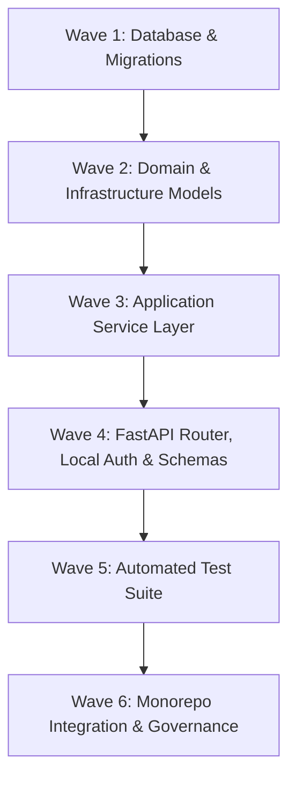

# Phase Plan: student-lifecycle/student-information End-to-End Build

**Module:** `student-lifecycle/student-information`  
**Issue:** #99 (`[073] Module: student-lifecycle/student-information`)  
**Owner:** Praveen (@praveen-rooman)  
**Milestone:** M3 Academy dashboards  
**Standard:** [docs/architecture/module-standard.md](file:///c:/Users/praveen%20v/Desktop/Education_OS/docs/architecture/module-standard.md)  
**Status:** Approved for Wave 1 execution (Pending final plan review)

---

## 1. Objective & Scope

Build the **Person System of Record (SIS)** module end-to-end adhering strictly to the Education OS architecture standard:
* Zero cross-module code imports (only `packages/*` and module-internal code).
* Complete multi-tenant row-level security (`app.organisation_id`) on PostgreSQL.
* Dedicated Alembic migration chain with forward upgrade and clean reverse downgrade.
* 100% contract fidelity with `contracts/openapi.yaml`, `contracts/events.yaml`, and `contracts/permissions.yaml`.
* Comprehensive test suite including cross-tenant leakage assertion from `eos_testing`.

### Key Capabilities & Architectural Decisions
1. **Person Master Record**: Identity, profile details, date of birth, contact details stored as `contact` (`email`, `phone`, `address`), guardian relations, optional `identity_user_id` account link, and provenance `source`.
2. **Duplicate Prevention**: Exact match check on `identity_number` within the organisation returning 409 `ConflictError` (`code: "duplicate_identity_number"`). Partial unique index at the database level.
3. **Immutable Status History**: Lifecycle states (`pending`, `active`, `suspended`, `graduated`, `withdrawn`, `alumnus`). Status changes require a reason and append to immutable history. Attempting to change to the identical current status returns 422 `RuleError` (`code: "status_unchanged"`).
4. **Document References**: References document artifacts stored in `platform/documents` (`identity_proof`, `address_proof`, `photograph`, `prior_transcript`, `other`). The module never handles raw file bytes.
5. **ID Card Issuance**: Logical card management (`issued`, `revoked`, `expired`). Exactly one active card per person enforced via partial unique index at the database level.
   * **Card Number Decision**: Generated using `IDC-{ORG4}-{YYYYMM}-{RANDOM6}` using `secrets.token_hex(3).upper()`, backed by a database unique constraint on `card_number` with collision retry (up to 3 attempts).
   * **Document ID Lifecycle Decision**: `document_id` is nullable upon initial issuance (`POST /people/{id}/id-cards` accepts only `IdentityCardInput` containing `expires_at?: date`). Later PDF/document generation attaches the artifact synchronously or via subsequent platform call. No asynchronous background workers are introduced.
6. **Domain Events & Contract Flags**:
   * Emits `student-information.person.created`, `updated`, `status-changed`, `id-card.issued`, `id-card.revoked`.
   * **Event Email Decision Flag**: `contracts/events.yaml` defines `email: string` in the event payload, whereas `contact.email` is optional in `openapi.yaml`. In accordance with user decision, empty string `""` will NOT be emitted by default; this contract discrepancy is flagged for formal confirmation with the contract owner/architecture lead before implementing event publishing.
7. **Security & Boundary Enforcement**:
   * Implements local `api/deps.py` using `eos_core.security.decode_token` and `eos_core.config.permissions_for`. Zero imports from `eos_identity` to prevent boundary check violations.
   * Session is transaction-scoped to tenant via `db.info["organisation_id"] = organisation_id`.

---

## 2. Architecture & File Layout

```
modules/student-lifecycle/student-information/
├── module.yaml                             # Status updated to in-progress -> stable
├── README.md                               # Service documentation & scope
├── CHANGELOG.md                            # Release notes
├── config/env.example                      # STUDENT_INFORMATION_* config keys
├── contracts/
│   ├── openapi.yaml                        # 0.1.0 API specification
│   ├── events.yaml                         # 5 domain events
│   └── permissions.yaml                    # 5 permissions
├── db/
│   ├── alembic.ini                         # Dedicated module version chain
│   └── migrations/
│       ├── env.py                          # Prefix student_information_, RLS enabled
│       ├── script.py.mako
│       └── versions/20261026_0001_initial.py
├── backend/
│   ├── pyproject.toml                      # Package eos-student-information
│   ├── src/eos_student_information/
│   │   ├── __init__.py
│   │   ├── domain/                         # Enums, value objects & status state machine
│   │   │   ├── __init__.py
│   │   │   └── enums.py
│   │   ├── infrastructure/                 # SQLAlchemy models, PREFIX="student_information_"
│   │   │   ├── __init__.py
│   │   │   └── models.py
│   │   ├── application/                    # Service layer, validation, event dispatch
│   │   │   ├── __init__.py
│   │   │   └── service.py
│   │   └── api/                            # FastAPI router, local deps, schemas
│   │       ├── __init__.py
│   │       ├── deps.py                     # Local token decoding & permission checks
│   │       ├── router.py                   # Route handlers mounted under /api/v1/student-information
│   │       └── schemas.py                  # Pydantic schemas mirroring openapi.yaml
│   └── tests/
│       ├── conftest.py                     # DB fixtures, auth stubs, test client
│       ├── test_domain.py                  # State machine & card number generator tests
│       ├── test_api_people.py              # CRUD, search (q, explode:false status), 409 duplicate check
│       ├── test_api_status.py              # Status change & immutable history (422 RuleError)
│       ├── test_api_documents.py           # Attach, list, delete document references
│       ├── test_api_id_cards.py            # Issue, 409 single active constraint, revoke, 409 inactive
│       ├── test_events.py                  # Event publishing verification
│       ├── test_contract_drift.py          # OpenAPI drift test
│       ├── test_tenancy_leak.py            # Cross-tenant leak test with eos_testing
│       └── test_migrations.py              # Alembic upgrade/downgrade test
└── frontend/
    └── src/widgets/index.ts                # Empty widgets export ("none yet")
```

---

## 3. Wave-based Execution Plan



### Wave 1: Database & Alembic Migrations
- **Tables** (prefix `student_information_`):
  1. `student_information_person`:
     - Columns: `id` (String(36) PK), `organisation_id` (String(36), indexed), `first_name` (String(120)), `last_name` (String(120)), `preferred_name` (String(120), nullable), `date_of_birth` (Date, nullable), `gender` (String(60), nullable), `identity_number` (String(100), nullable), `contact` (JSON, nullable), `guardians` (JSON, nullable), `identity_user_id` (String(36), nullable), `status` (String(20)), `status_effective_date` (Date), `source` (JSON, nullable), `created_at` (DateTime TZ), `updated_at` (DateTime TZ).
     - Indexes & Constraints:
       - `ix_student_information_person_organisation_id`
       - Partial Unique Index: `CREATE UNIQUE INDEX uq_student_info_person_identity ON student_information_person (organisation_id, identity_number) WHERE identity_number IS NOT NULL;`
  2. `student_information_status_history`:
     - Columns: `id` (String(36) PK), `organisation_id` (String(36), indexed), `person_id` (String(36), FK to `student_information_person.id`, indexed), `status` (String(20)), `previous_status` (String(20), nullable), `reason` (Text), `effective_date` (Date), `changed_by` (String(36)), `changed_at` (DateTime TZ).
     - Indexes:
       - `ix_student_information_status_history_organisation_id`
       - `ix_student_information_status_history_person_id`
  3. `student_information_document`:
     - Columns: `id` (String(36) PK), `organisation_id` (String(36), indexed), `person_id` (String(36), FK to `student_information_person.id`, indexed), `type` (String(40)), `document_id` (String(36)), `label` (String(200), nullable), `uploaded_by` (String(36)), `uploaded_at` (DateTime TZ).
     - Indexes:
       - `ix_student_information_document_organisation_id`
       - `ix_student_information_document_person_id`
  4. `student_information_id_card`:
     - Columns: `id` (String(36) PK), `organisation_id` (String(36), indexed), `person_id` (String(36), FK to `student_information_person.id`, indexed), `card_number` (String(60), unique), `status` (String(20)), `expires_at` (Date, nullable), `document_id` (String(36), nullable), `issued_by` (String(36)), `issued_at` (DateTime TZ), `revoked_by` (String(36), nullable), `revoked_at` (DateTime TZ, nullable), `revoked_reason` (Text, nullable).
     - Indexes & Constraints:
       - `ix_student_information_id_card_organisation_id`
       - `ix_student_information_id_card_person_id`
       - Unique constraint on `card_number`
       - Partial Unique Index: `CREATE UNIQUE INDEX uq_student_info_active_card ON student_information_id_card (organisation_id, person_id) WHERE status = 'issued';`
- **Alembic Configuration**:
  - `modules/student-lifecycle/student-information/db/alembic.ini`
  - `modules/student-lifecycle/student-information/db/migrations/env.py` (reads `VERSION_TABLE = "student_information_alembic_version"`, filters prefix `student_information_`)
  - `modules/student-lifecycle/student-information/db/migrations/versions/20261026_0001_initial.py` (implements `_enable_rls` using `eos_core.rls.POLICY` and clean table drop on `downgrade()`).

### Wave 2: Domain Entities & Infrastructure Models
- Directory: `modules/student-lifecycle/student-information/backend/src/eos_student_information`
- `domain/enums.py`:
  - `PersonStatus`: `pending`, `active`, `suspended`, `graduated`, `withdrawn`, `alumnus`.
  - `DocumentType`: `identity_proof`, `address_proof`, `photograph`, `prior_transcript`, `other`.
  - `IdCardStatus`: `issued`, `revoked`, `expired`.
- `infrastructure/models.py`:
  - `Base = DeclarativeBase`, `TenantMixin`, `TimestampMixin`.
  - Prefix `PREFIX = "student_information_"`.
  - Tables: `Person`, `StatusHistoryEntry`, `PersonDocument`, `IdentityCard`.
  - Serializers mapping columns to API contract dictionaries (`contact` mapping to dictionary containing `email`, `phone`, `address`).

### Wave 3: Application Service Layer & Event Publishing
- `application/service.py`:
  - `generate_card_number(db, organisation_id)`:
    - Generates `IDC-{ORG4}-{YYYYMM}-{RANDOM6}`.
    - Implements collision detection with up to 3 retries against the unique constraint.
  - `create_person(db, organisation_id, actor_id, data)`:
    - Checks exact duplicate `identity_number` within the organisation -> raises 409 `ConflictError(code="duplicate_identity_number")`.
    - Creates `Person` record in `pending` status.
    - Appends initial entry to `status_history`.
    - Emits `student-information.person.created` (respecting email flag decision).
  - `get_person(db, organisation_id, person_id)`:
    - Returns person or raises 404 `NotFound`.
  - `list_people(db, organisation_id, q, identity_number, status, page, page_size)`:
    - Implements exact match on `identity_number`.
    - Implements comma-separated / list status filtering (`explode: false`).
    - Partial case-insensitive search `q` on `first_name`, `last_name`, and `contact->>'email'`.
    - Returns paginated `PersonPage`.
  - `update_person(db, organisation_id, person_id, updates)`:
    - Checks duplicate `identity_number` if modified -> raises 409 `ConflictError`.
    - Updates profile fields (does not allow direct status change).
    - Emits `student-information.person.updated`.
  - `change_status(db, organisation_id, person_id, actor_id, new_status, reason, effective_date)`:
    - If `new_status == current_status` -> raises 422 `RuleError(code="status_unchanged")`.
    - Updates `Person.status` and `Person.status_effective_date`.
    - Appends new immutable entry to `status_history`.
    - Emits `student-information.person.status-changed`.
  - `attach_document(db, organisation_id, person_id, actor_id, doc_data)`:
    - Verifies person exists in organisation.
    - Creates `PersonDocument` record -> returns 201.
  - `delete_document(db, organisation_id, person_id, document_id)`:
    - Deletes document reference -> returns 204.
  - `issue_id_card(db, organisation_id, person_id, actor_id, card_data)`:
    - Checks for existing card in `issued` status -> raises 409 `ConflictError(code="active_card_exists")`.
    - Generates unique card number and creates card in `issued` status with `document_id=None`.
    - Emits `student-information.id-card.issued`.
  - `revoke_id_card(db, organisation_id, card_id, actor_id, reason)`:
    - If card not found in organisation -> raises 404 `NotFound`.
    - If card status is not `issued` -> raises 409 `ConflictError(code="card_not_active")`.
    - Sets card status to `revoked`, records `revoked_by`, `revoked_at`, `revoked_reason`.
    - Emits `student-information.id-card.revoked`.

### Wave 4: FastAPI Router, Local Auth Dependencies & Schemas
- `api/deps.py`:
  - `current_actor`: Decodes bearer JWT using `eos_core.security.decode_token`. Extracts `org`, `sub`, and roles. Maps permissions using `eos_core.config.permissions_for`.
  - Scopes transaction context: sets `db.info["organisation_id"] = organisation_id`.
  - `require(*permissions)`: Dependency enforcing required permission.
- `api/schemas.py`:
  - Pydantic models matching `contracts/openapi.yaml`:
    - `ContactDetails`, `Guardian`, `Source`
    - `PersonInput` (`contact: Optional[ContactDetails]`, no `status`)
    - `PersonUpdate`
    - `Person` (`allOf: [PersonInput, {id, organisation_id, status, status_effective_date, created_at, updated_at}]`)
    - `PersonPage` (`items`, `total`, `page`, `page_size`)
    - `StatusChangeInput` (`status`, `reason`, `effective_date`)
    - `StatusHistoryEntry` (`id`, `person_id`, `organisation_id`, `status`, `reason`, `effective_date`, `changed_by`, `changed_at`)
    - `PersonDocumentInput` (`type`, `document_id`, `label`)
    - `PersonDocument` (`id`, `person_id`, `organisation_id`, `type`, `document_id`, `label`, `uploaded_by`, `uploaded_at`)
    - `IdentityCardInput` (`expires_at`)
    - `IdentityCard` (`id`, `person_id`, `organisation_id`, `card_number`, `status`, `expires_at`, `document_id`, `issued_by`, `issued_at`, `revoked_by`, `revoked_at`, `revoked_reason`)
    - `ConflictError` (`code`: `duplicate_identity_number` | `active_card_exists` | `card_not_active`, `message`)
    - `RuleError` (`code`: `status_unchanged`, `message`)
- `api/router.py`:
  - Routes mapped to endpoints with required permissions:
    - `GET /people` -> `student-information:person:read`
    - `POST /people` -> `student-information:person:write`
    - `GET /people/{id}` -> `student-information:person:read`
    - `PATCH /people/{id}` -> `student-information:person:write`
    - `GET /people/{id}/status` -> `student-information:person:read`
    - `PUT /people/{id}/status` -> `student-information:status:manage`
    - `GET /people/{id}/documents` -> `student-information:person:read`
    - `POST /people/{id}/documents` -> `student-information:document:manage`
    - `DELETE /people/{id}/documents/{document_id}` -> `student-information:document:manage`
    - `GET /people/{id}/id-cards` -> `student-information:person:read`
    - `POST /people/{id}/id-cards` -> `student-information:id-card:manage`
    - `POST /id-cards/{id}/revoke` -> `student-information:id-card:manage`

### Wave 5: Automated Test Suite
- `backend/tests/`:
  - `conftest.py`: SQLite/PostgreSQL engine fixtures, JWT token minting for test roles.
  - `test_domain.py`: Status state machine transitions, card number generation & collision retry.
  - `test_api_people.py`: CRUD, search with `q`, `explode: false` status filtering (`?status=pending,active`), duplicate `identity_number` (409 ConflictError).
  - `test_api_status.py`: Status changes, immutable history ordering, 422 `status_unchanged` RuleError.
  - `test_api_documents.py`: Attach, list, delete document metadata.
  - `test_api_id_cards.py`: Card issuance, 409 on second active card, card revocation, 409 when revoking inactive card.
  - `test_events.py`: Verifies event outbox records for all 5 lifecycle events.
  - `test_contract_drift.py`: Compares FastAPI router routes against `contracts/openapi.yaml`.
  - `test_tenancy_leak.py`: Multi-tenant isolation verified with `eos_testing.tenancy.assert_no_cross_tenant_leak`.
  - `test_migrations.py`: Applies Alembic `upgrade head` and `downgrade base` verifying clean table creation and teardown.

### Wave 6: Monorepo Integration & Documentation
- **Packaging:**
  - Create `modules/student-lifecycle/student-information/backend/pyproject.toml` using approved dependencies.
  - Run `pip install -e modules/student-lifecycle/student-information/backend`.
- **Host Module Registration:**
  - Register in `apps/backend/config/modules.enabled.yaml` under `modules:` (`- student-lifecycle/student-information`).
- **Manifest & Docs:**
  - Update `module.yaml` status to `in-progress` (or `stable`).
  - Update `README.md` and `CHANGELOG.md`.
  - Update `config/env.example` with `STUDENT_INFORMATION_` variables.
  - Confirm `frontend/src/widgets/index.ts` exports `export const widgets: DashboardWidget[] = [];`.
- **Precheck & Governance Execution:**
  - Execute `precheck.sh` and ensure 100% passing checks.

---

## 4. Verification Gates

| Gate | Check | Expected Result |
|---|---|---|
| **Approved Stack** | `python tools/scripts/check-stack.py` | 0 forbidden dependencies |
| **Module Boundaries** | `python tools/scripts/check-boundaries.py` | 0 illegal imports |
| **Manifests** | `python tools/scripts/check-manifests.py` | Manifest complete and valid |
| **Migration Standard** | `python tools/scripts/check-migrations.py` | `organisation_id` + RLS on all 4 tables |
| **Linter & Formatter** | `ruff check` & `ruff format --check` | 0 lint or formatting errors |
| **Module Test Suite** | `pytest modules/student-lifecycle/student-information/backend/tests` | 100% tests passing |
| **Tenant Leak Test** | `test_tenancy_leak.py` | Zero cross-tenant leakage |
